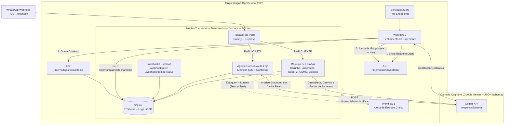
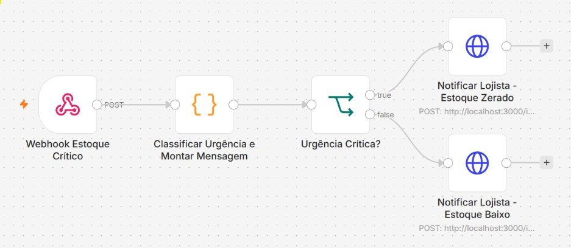
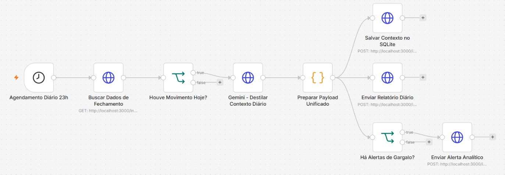

# whatFood — Assistente Conversacional de Delivery e Gestão Operacional via WhatsApp

Protótipo funcional de uma extensão conversacional ponta a ponta pensada para o ecossistema **iFood** dentro do **WhatsApp**, unindo duas jornadas em um único canal: **descoberta e vendas para o consumidor** e **gestão operacional assistida por IA para o restaurante parceiro**.

---

## Proposta de Valor

* **Inclusão e expansão de base (*zero-rating*):** No Brasil, milhões de usuários ficam sem pacote de dados ativo, mas mantêm acesso liberado ao WhatsApp pela operadora (*zero-rating*) ou utilizam aparelhos com armazenamento limitado. Enquanto o aplicativo tradicional exige internet plena, o `whatFood` permite descobrir lojas, montar o carrinho e concluir pedidos de ponta a ponta **100% dentro do WhatsApp** — viabilizado pelos métodos de pagamento já salvos no iFood (validados via SMS) e pelo pagamento na entrega/retirada, além do Pix para quem possui acesso ao app bancário.
* **Menor atrito na conversão:** Jornada natural em linguagem livre para descoberta e montagem do carrinho, combinada com etapas determinísticas curtas no checkout.
* **Inteligência operacional para o parceiro:** Conversas anonimizadas e dados transacionais do dia deixam de ser apenas histórico de chat e passam a gerar alertas proativos de estoque, relatórios de fechamento e um agente consultivo para o lojista no próprio WhatsApp.

---

## Arquitetura do Sistema

O projeto adota uma **arquitetura híbrida**, separando o **núcleo transacional crítico** (Node.js + SQLite), a **camada cognitiva** (Google Gemini com saída estruturada) e a **orquestração operacional assíncrona** (n8n):



### Fluxos Visuais no n8n

#### 1. Alerta de Estoque Crítico (Tempo Real)
Recebe o disparo imediato do backend sempre que uma venda reduz o estoque de um item para o mínimo ou zero, classifica a urgência (`ATENCAO` vs. `CRITICA`) e aciona a notificação ao lojista.



#### 2. Fechamento do Expediente (Lote Diário)
Executado ao fim do expediente, coleta métricas SQL e interações anonimizadas do dia, evita custo de IA em dias sem movimento, gera análise estruturada via Gemini e alimenta em paralelo o banco de contextos, o relatório executivo e alertas de gargalo.



---

## Principais Funcionalidades

### Jornada do Consumidor (`CLIENTE`)
* **Descoberta em 2 etapas:** Apresenta primeiro as lojas abertas que atendem o bairro do cliente (sem despejar preços) e só exibe o cardápio após a escolha. Quando há apenas uma loja compatível, convida diretamente para o cardápio.
* **Segurança de interface e catálogo real:** Oculta IDs internos da resposta ao usuário, respeita disponibilidade/estoque em tempo real e captura observações espontâneas dos itens (ex.: *"bem quentinho"*, *"sem cebola"*).
* **Proteção de carrinho e logística:** Solicita confirmação explícita ao tentar misturar itens de lojas diferentes, suporta entrega ou retirada sem taxa, permite escolher ou cadastrar novos endereços com extração estruturada via IA e bloqueia entregas fora da área atendida pela loja.
* **Resumo transparente e precificação real:** Gera nota resumida discriminando itens, observações, subtotal, taxa de entrega e **taxa de serviço padrão (R$ 0,99)**, com todos os cálculos financeiros feitos em centavos inteiros.
* **Pagamentos e segurança:**
  * **Pix Copia e Cola** com confirmação assíncrona e webhook idempotente (`POST /webhook/pix`).
  * **Meus métodos de pagamento do iFood** (Cartão salvo com parcelamento de **1x sem juros a 6x com juros** e **Saldo da Carteira iFood**) protegidos por **2FA via SMS** (código de 6 dígitos com limite de 3 tentativas).
  * **Pagamento na entrega / retirada.**
* **Desvios semânticos sem travamento:** Mesmo no meio de menus numéricos do checkout, o cliente pode consultar o status de um pedido anterior, alterar itens ou cancelar a compra em linguagem natural.
* **Esteira de status operacional:** Atualização controlada (`CONFIRMADO` → `EM_PREPARO` → `SAIU_PARA_ENTREGA` / `PRONTO_PARA_RETIRADA` → `ENTREGUE` ou `CANCELADO`), com bloqueio após estados finais e restauração automática de estoque em caso de cancelamento.

### Jornada do Parceiro e Operação (`LOJISTA`)
* **Controle de estoque proativo:** Baixa automática por pedido, pausa automática do produto ao zerar (`disponivel = 0`) e disparo imediato de webhook para o n8n ao atingir o estoque mínimo.
* **Registro anonimizado de interações (LGPD):** Persistência das interações na tabela `interacoes` usando hash SHA-256 com *salt* no telefone e sanitização de PII (telefones, CPFs e e-mails) antes de qualquer uso analítico.
* **Pipeline diário de inteligência (n8n):** Transforma métricas SQL e conversas anonimizadas em três artefatos — **contexto estruturado** (demanda não atendida, motivos de abandono, observações recorrentes), **relatório executivo** e **alertas de gargalo**.
* **Agente consultivo no WhatsApp:** Ao reconhecer um número com perfil `LOJISTA`, o mesmo `/webhook` atua como assistente de gestão, cruzando faturamento/estoque em tempo real com os contextos destilados dos últimos 7 dias sem inventar números.

---

## Decisões Arquiteturais e Trade-offs de MVP

### 1. Roteamento Híbrido (IA Semântica vs. Núcleo Determinístico)
LLMs são excelentes para interpretar intenção, linguagem informal e endereços livres, mas não devem controlar regras críticas de negócio. Por isso, o **Gemini** atua sempre com `responseSchema` (JSON tipado) restrito à camada semântica, enquanto **cálculos monetários (em centavos), validação de estoque, controle de sessão, 2FA por SMS e transição de pedidos** são 100% determinísticos no Node.js.

### 2. Catálogo no System Prompt vs. Function Calling
Para validar o MVP com menor latência (apenas 1 chamada de LLM por turno) e simplicidade de depuração, as lojas abertas do bairro do cliente são injetadas diretamente no `systemPrompt`. Esse é um **trade-off consciente de escopo**: com o crescimento para centenas ou milhares de lojas por região, o volume de tokens tornaria essa abordagem inviável em custo e contexto, sendo a migração para **Function Calling + busca indexada/semântica** o passo natural para produção.

### 3. Por que n8n fora do Backend Transacional
A separação entre **vendas** (Node.js) e **orquestração operacional** (n8n) foi intencional e baseada em três pilares:
* **Resiliência:** Falhas em alertas, relatórios ou integrações externas nunca derrubam o fluxo de checkout.
* **Agilidade sem deploy:** Alterar canais de notificação (WhatsApp, e-mail, Slack), horários de fechamento ou prompts analíticos pode ser feito visualmente sem mexer no código transacional.
* **Foco no domínio:** Evita código descartável de agendadores, retentativas e conectores no servidor principal.

### 4. Análise Híbrida e Privacidade (LGPD)
Contagens financeiras, ticket médio, estoque e funil são calculados de forma exata em **SQL** — nunca delegados a um LLM. O modelo de linguagem recebe apenas os agregados confiáveis somados às mensagens anonimizadas para extrair sinais qualitativos. Em escala de produção, essa arquitetura evolui naturalmente com **amostragem estratificada** de interações para manter o custo previsível.

---

## Stack Tecnológica e Estrutura do Projeto

* **Runtime & API:** Node.js (22.5+ com `node:sqlite` nativo) e Express
* **IA Generativa:** Google Gemini API (`@google/generative-ai` com saída JSON estruturada e fallback de modelos)
* **Banco de Dados:** SQLite (`whatfood.sqlite`, 7 tabelas relacionais)
* **Orquestração:** n8n (workflows versionados em JSON)

```text
whatFood/
├── docs/
│   ├── n8n-estoque-critico.jpg
│   └── n8n-fechamento-expediente.jpg
├── n8n/
│   ├── workflow-estoque-critico.json
│   └── workflow-fechamento-expediente.json
├── src/
│   ├── db.js
│   ├── seed.js
│   └── server.js
├── .env.example
├── .gitignore
├── package.json
└── README.md
```

---

## Como Executar Localmente

### Pré-requisitos
* **Node.js 22.5+** (necessário para o módulo nativo `node:sqlite`)
* Chave de API do **Google Gemini** (`GEMINI_API_KEY`)

### 1. Instalar dependências e configurar ambiente
```bash
npm install
cp .env.example .env
```

Preencha sua `GEMINI_API_KEY` no arquivo `.env` (os demais valores padrão do `.env.example` já funcionam para desenvolvimento local).

### 2. Popular o banco SQLite e iniciar o servidor
```bash
node src/seed.js
npm start
```

O seed cria **10 lojas**, **32 produtos** e duas contas prontas para teste:
* **Cliente (`CLIENTE`):** `5511999990001` (Gabriel — bairro padrão `Pinheiros`, 2 endereços salvos, saldo R$ 35,00)
* **Lojista (`LOJISTA`):** `5511999990002` (Marina — gestora da loja *Doce da Vila*)

### 3. Subir o n8n localmente e importar os workflows (opcional)
No PowerShell:
```powershell
$env:N8N_BLOCK_ENV_ACCESS_IN_NODE="false"
$env:INTERNAL_API_KEY="whatfood-dev-key"
$env:GEMINI_API_KEY="sua_chave_gemini_aqui"
$env:GEMINI_MODEL="gemini-3.5-flash-lite"
npx n8n
```

Acesse `http://localhost:5678`, importe `n8n/workflow-estoque-critico.json` (ative/publique o workflow para escutar `/webhook/whatfood-estoque`) e `n8n/workflow-fechamento-expediente.json`.

### Principais Endpoints

| Método | Rota | Descrição |
| :--- | :--- | :--- |
| `POST` | `/webhook` | Entrada principal de mensagens WhatsApp (`CLIENTE` e `LOJISTA`) |
| `POST` | `/webhook/pix` | Confirmação assíncrona e idempotente de pagamento Pix |
| `POST` | `/webhook/pedido-status` | Avanço na esteira operacional e estorno de estoque em cancelamentos |
| `GET` | `/pedidos/:whatsapp` | Histórico de pedidos do cliente |
| `GET` | `/enderecos/:whatsapp` | Endereços salvos do cliente |
| `GET` | `/interno/lojas/:lojaId/fechamento` | Métricas SQL, estoque e interações anonimizadas do dia (`x-api-key`) |
| `POST` | `/interno/lojas/:lojaId/contexto` | Persistência do contexto, relatório e alertas gerados pelo n8n (`x-api-key`) |
| `GET` | `/interno/lojas/:lojaId/contextos` | Consulta dos contextos diários recentes da loja (`x-api-key`) |
| `GET` | `/interno/lojas/:lojaId/estoque` | Consulta detalhada de estoque da loja (`x-api-key`) |
| `POST` | `/interno/alertas/notificar` | Receptor de notificações proativas disparadas pelo n8n (`x-api-key`) |

### Exemplo rápido de chamada (PowerShell)
```powershell
(Invoke-RestMethod -Method Post -Uri 'http://localhost:3000/webhook' `
  -ContentType 'application/json; charset=utf-8' `
  -Body '{"from":"5511999990001","text":"oi, quero um doce"}').resposta
```

---

## Roadmap de Evolução (Pós-MVP)

* **Clube iFood e motor promocional de cupons:** Aplicação automática de benefícios para assinantes, cupons com pedido mínimo, controle de uso único e regra de divisão de subsídio entre plataforma e restaurante.
* **Catálogo escalável via Function Calling:** Substituição da injeção direta no prompt por ferramentas de busca estruturada/semântica por região, categoria e disponibilidade.
* **Persistência distribuída de sessão e dados:** Migração das sessões em memória para **Redis** (com TTL e suporte a múltiplas instâncias) e do SQLite para **PostgreSQL**.
* **Sincronização bidirecional com o ecossistema principal:** Integração real de endereços cadastrados no WhatsApp, carteira digital e gateway de pagamentos com o aplicativo principal.
* **Amostragem estratificada em larga escala:** Seleção inteligente de conversas representativas no pipeline do n8n para lojas com alto volume diário de atendimentos.
* **Interface web de demonstração e deploy em nuvem:** Simulador visual de WhatsApp + painel do parceiro hospedados em nuvem.

---

## Autor

**Gabriel Ribeiro de Sousa**  
Contato: `gabrrsousa@gmail.com`

> *Nota: Projeto independente desenvolvido para fins de estudo, arquitetura de software e portfólio, inspirado no ecossistema do iFood e sem vínculo oficial com a marca.*